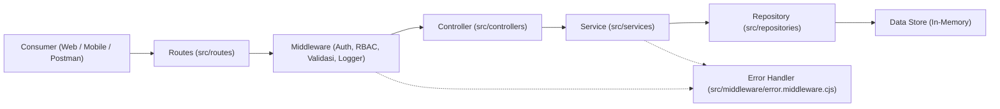

# SIMADU API — Sistem Layanan Informasi dan Pengaduan Mahasiswa

REST API berlapis berbasis **Node.js**, **Express 5**, dan **JSON** untuk layanan pengaduan mahasiswa (Fasilitas, Akademik, dan TI) dengan mekanisme autentikasi **JWT Bearer Token**, otorisasi berbasis peran (**RBAC**) & kepemilikan data, validasi ketat (whitelist field), serta dokumentasi interaktif **OpenAPI 3.0 & Swagger UI**.

---

## 1. Prasyarat

- **Node.js** versi `>= 20.0.0` (diuji pada Node.js v24)
- **npm** versi `>= 10.0.0`
- HTTP Client untuk pengujian manual: **Postman**, **Swagger UI**, atau ekstensi **REST Client** (`tests/requests.http`)

---

## 2. Instalasi & Konfigurasi

1. Masuk ke direktori proyek:
   ```bash
   cd simadu-api
   ```
2. Pasang seluruh dependensi:
   ```bash
   npm install
   ```
3. Salin file `.env.example` menjadi `.env`:
   ```bash
   cp .env.example .env
   ```
   *(Di Windows PowerShell: `Copy-Item .env.example .env`)*
4. Sesuaikan variabel lingkungan di dalam `.env`:
   ```env
   PORT=3000
   NODE_ENV=development
   JWT_SECRET=simadu_uts_wse_2026_super_secret_key_change_in_production
   JWT_EXPIRES_IN=1h
   REQUIRE_API_KEY=false
   API_KEY=simadu-client-api-key-2026
   ```

---

## 3. Menjalankan Server

- Mode normal:
  ```bash
  npm start
  ```
- Mode pengembangan (auto-reload):
  ```bash
  npm run dev
  ```

Setelah server aktif:
- **Base URL**: `http://localhost:3000`
- **Swagger UI**: `http://localhost:3000/api-docs`
- **Spesifikasi OpenAPI JSON**: `http://localhost:3000/api-docs.json`
- **Health Check**: `http://localhost:3000/api/health`

---

## 4. Arsitektur & Pembagian Tanggung Jawab

SIMADU API menggunakan arsitektur **REST API berlapis (Layered Architecture)** agar setiap komponen memiliki tanggung jawab tunggal yang jelas dan mudah diuji:



| Lapisan | Direktori | Tanggung Jawab |
| :--- | :--- | :--- |
| **Router** | `src/routes/` | Mendefinisikan jalur endpoint HTTP (`GET`, `POST`, `PUT`, `PATCH`, `DELETE`) dan merangkai urutan middleware sebelum memanggil controller. |
| **Middleware** | `src/middleware/` | Menangani fungsi lintas lapisan: verifikasi JWT Bearer Token (`auth.middleware.cjs`), otorisasi peran (`authorize.middleware.cjs`), validasi skema & whitelist field (`validate.middleware.cjs`), logging aman tanpa token/password (`logger.middleware.cjs`), dan penanganan kesalahan terpusat (`error.middleware.cjs`). |
| **Controller** | `src/controllers/` | Adaptor protokol HTTP: menerima data tervalidasi dari `req`, memanggil service terkait, dan menyusun respons JSON dengan status HTTP yang tepat (`200`, `201`). |
| **Service** | `src/services/` | Memuat logika bisnis inti, seperti verifikasi hash password & penerbitan JWT, penyaringan data berdasarkan peran, validasi kepemilikan (`mahasiswaId`), serta aturan status (`diajukan`) untuk ubah/hapus. |
| **Repository** | `src/repositories/` | Mengelola akses dan penyimpanan data pengguna serta pengaduan secara terisolasi, mengembalikan salinan objek agar state internal terlindungi. |

---

## 5. Struktur Direktori

```text
simadu-api/
├── src/
│   ├── controllers/
│   │   ├── auth.controller.cjs
│   │   └── pengaduan.controller.cjs
│   ├── services/
│   │   ├── auth.service.cjs
│   │   └── pengaduan.service.cjs
│   ├── repositories/
│   │   ├── user.repository.cjs
│   │   └── pengaduan.repository.cjs
│   ├── routes/
│   │   ├── auth.routes.cjs
│   │   └── pengaduan.routes.cjs
│   └── middleware/
│       ├── auth.middleware.cjs
│       ├── authorize.middleware.cjs
│       ├── validate.middleware.cjs
│       ├── logger.middleware.cjs
│       └── error.middleware.cjs
├── docs/
│   └── openapi.json
├── tests/
│   ├── api.test.cjs
│   ├── run-scenarios.cjs
│   ├── requests.http
│   └── simadu-api.postman_collection.json
├── app.cjs
├── server.cjs
├── package.json
├── .env.example
├── .gitignore
└── README.md
```

---

## 6. Akun Uji Awal & Mekanisme Autentikasi

Seluruh password pengguna disimpan dalam bentuk **hash bcrypt** (bukan plaintext) pada `src/repositories/user.repository.cjs`.

| Username | Password (Uji) | Peran (`role`) | `mahasiswaId` | Nama |
| :--- | :--- | :--- | :--- | :--- |
| `mhs01` | `Mhs12345!` | `mahasiswa` | `240101001` | Ahmad Fauzi |
| `mhs02` | `Mhs67890!` | `mahasiswa` | `240101002` | Siti Rahma |
| `admin01` | `Admin12345!` | `admin` | `null` | Budi Santoso |

**Mekanisme Bearer Token:**
1. Kirim `POST /api/auth/login` dengan JSON `{ "username": "...", "password": "..." }`.
2. Server memverifikasi hash password dengan `bcryptjs.compare` dan menerbitkan JWT unik (`jti` acak per sesi, ditandatangani `HS256`, memiliki waktu kedaluwarsa `JWT_EXPIRES_IN`).
3. Sertakan token pada setiap endpoint `/api/pengaduan` melalui header:
   ```http
   Authorization: Bearer <token>
   ```

---

## 7. Matriks Hak Akses

| Operasi | Mahasiswa | Administrator | Kebijakan Tambahan |
| :--- | :---: | :---: | :--- |
| Melihat pengaduan sendiri | ✅ | ✅ | Mahasiswa hanya melihat miliknya |
| Melihat semua pengaduan | ❌ | ✅ | `GET /api/pengaduan` memfilter otomatis sesuai peran |
| Membuat pengaduan | ✅ | ❌ | `id`, `mahasiswaId`, `status`, `createdAt` diisi server |
| Mengubah pengaduan sendiri | ✅ | ❌ | Hanya pemilik & hanya selama status `diajukan` |
| Menghapus pengaduan sendiri | ✅ | ❌ | Hanya pemilik & hanya selama status `diajukan` |
| Mengubah status pengaduan | ❌ | ✅ | Admin tidak dapat mengubah `mahasiswaId` |

---

## 8. Kontrak Endpoint & Contoh JSON

| Metode | Endpoint | Akses | Status Sukses | Fungsi |
| :--- | :--- | :--- | :---: | :--- |
| `POST` | `/api/auth/login` | Publik | `200` | Autentikasi pengguna & penerbitan token |
| `GET` | `/api/pengaduan` | Mahasiswa, Admin | `200` | Mengambil daftar pengaduan sesuai hak akses |
| `GET` | `/api/pengaduan/:id` | Mahasiswa (pemilik), Admin | `200` | Mengambil detail pengaduan |
| `POST` | `/api/pengaduan` | Mahasiswa | `201` | Menambahkan pengaduan baru |
| `PUT` | `/api/pengaduan/:id` | Mahasiswa (pemilik, `diajukan`) | `200` | Mengubah `judul`, `kategori`, `deskripsi` |
| `PATCH` | `/api/pengaduan/:id/status` | Admin | `200` | Memperbarui `status` (`diajukan`/`diproses`/`selesai`) |
| `DELETE` | `/api/pengaduan/:id` | Mahasiswa (pemilik, `diajukan`) | `200` | Menghapus pengaduan |

### Contoh Request `POST /api/pengaduan`
```json
{
  "judul": "AC Ruang Kuliah R-301 Tidak Dingin",
  "kategori": "Fasilitas",
  "deskripsi": "AC di ruang kuliah R-301 mati sejak kemarin siang sehingga perkuliahan tidak nyaman."
}
```

### Contoh Response `201 Created`
```json
{
  "success": true,
  "message": "Pengaduan berhasil dibuat.",
  "data": {
    "id": 4,
    "mahasiswaId": "240101001",
    "judul": "AC Ruang Kuliah R-301 Tidak Dingin",
    "kategori": "Fasilitas",
    "deskripsi": "AC di ruang kuliah R-301 mati sejak kemarin siang sehingga perkuliahan tidak nyaman.",
    "status": "diajukan",
    "createdAt": "2026-11-26T06:50:00.000Z"
  }
}
```

### Format Respons Kesalahan (`400`, `401`, `403`, `404`, `500`)
```json
{
  "success": false,
  "message": "Validasi data pengaduan gagal.",
  "errors": [
    "Field judul wajib diisi.",
    "Field deskripsi wajib diisi."
  ]
}
```

---

## 9. Menjalankan Pengujian

- Jalankan seluruh 20 test case otomatis (`node:test`):
  ```bash
  npm test
  ```
- Jalankan 18 skenario fungsional & keamanan sekaligus menyimpan bukti JSON aktual ke `tests/test-results.json`:
  ```bash
  npm run test:report
  ```
- Pengujian manual via Postman: impor `tests/simadu-api.postman_collection.json`.
- Pengujian manual via VS Code REST Client: buka `tests/requests.http`.
- Pengujian interaktif via Swagger UI: buka `http://localhost:3000/api-docs`.
